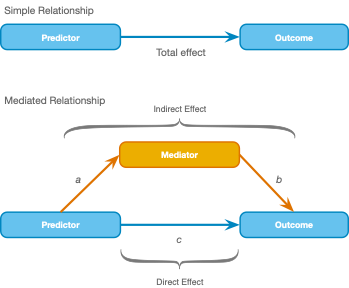
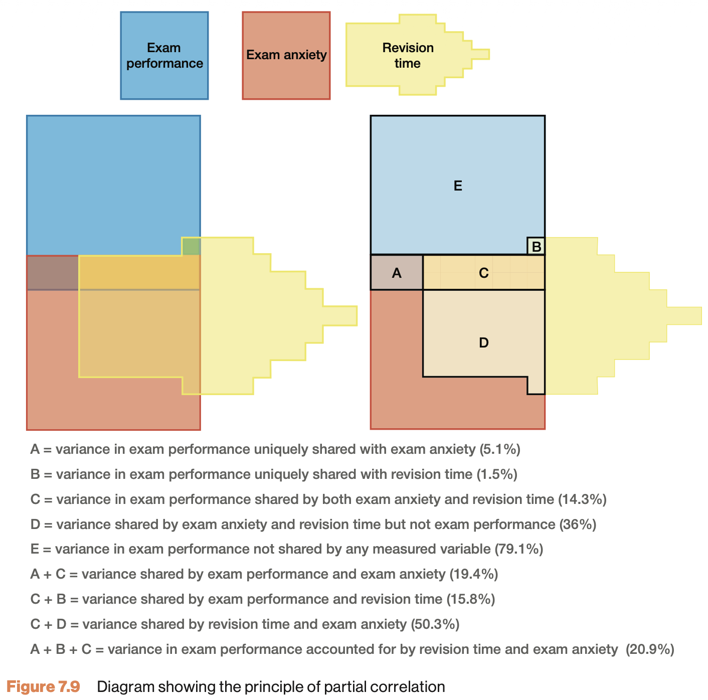

<!-- Opens with the MultiRegression applet (correlated predictors), carried over from the end of
     lecture 21. Same slide as in lecture 21. -->

## Applet

[Link](https://jvd-ssr-multiple-regression.share.connect.posit.cloud/)

<!-- His request (2026-10-27): introduce the diagram convention before mediation, with lecture 21's
     album sales model (the applet's variables, b1 and b2 as in lecture 21). Lines rather than
     arrows, because a regression makes no causal claim; the mediation model (Path plot) gets the
     arrows. DSUJ draws arrows in the same kind of diagram (Figure 10.5), so the lines are ours. -->

## Multiple regression

$\widehat{\text{album sales}} = b_0 + b_1 \text{airplay} + b_2 \text{adverts}$

```{r med-regression-diagram, echo=FALSE, fig.width=8, fig.height=2.6}
# A regression model as a diagram: predictors on the left, the outcome on the right, one line per
# coefficient. Units are inches (par("pin")), so boxes and text keep one size in panels of any
# height. Used again on "View beta coefficients" (children share one R session, in wrapper order).
draw.regression <- function(predictors, outcome, labels, fill, main = NULL) {
  par(mar = c(0, 0, 0, 0), cex = 1)                  # layout() with 3 rows would shrink text to 0.66
  plot.new()
  size <- par("pin")
  plot.window(xlim = c(0, size[1]), ylim = c(0, size[2]), xaxs = "i", yaxs = "i")
  box.w <- 1.2
  box.h <- 0.3
  top   <- size[2]
  if (!is.null(main)) {
    text(0.05, top - 0.05, main, adj = c(0, 1), font = 2, cex = 1.4)
    top <- top - 0.45
  }
  mid <- top / 2
  y.p <- if (length(predictors) == 1) mid else mid + c(0.6, -0.6)
  pos <- c(setNames(lapply(y.p, function(y) c(box.w + 0.05, y)), predictors),
           setNames(list(c(size[1] - box.w - 0.05, mid)), outcome))
  # Point where the line from one box centre to another leaves the box
  clip <- function(from, to) {
    d <- to - from
    from + min(box.w / abs(d[1]), box.h / abs(d[2])) * d
  }
  for (i in seq_along(predictors)) {
    from <- clip(pos[[predictors[i]]], pos[[outcome]])
    to   <- clip(pos[[outcome]], pos[[predictors[i]]])
    segments(from[1], from[2], to[1], to[2], lwd = 2)
    side <- if (i == 2) -1 else 1                     # label above the first line, below the second
    text(mean(c(from[1], to[1])), mean(c(from[2], to[2])) + side * 0.3, labels[[i]], cex = 1.5)
  }
  for (v in names(pos)) {
    rect(pos[[v]][1] - box.w, pos[[v]][2] - box.h, pos[[v]][1] + box.w, pos[[v]][2] + box.h,
         col = fill[[v]], border = "grey20", lwd = 2)
    text(pos[[v]][1], pos[[v]][2], v, cex = 1.5)
  }
}

draw.regression(c("Airplay", "Adverts"), "Album sales", list(quote(b[1]), quote(b[2])),
                c(Airplay = "lightskyblue", Adverts = "lightskyblue", "Album sales" = "lightskyblue"))
```

- Boxes are variables, lines are $b$s
- No arrows, so no causal claim

# Mediation {.section}

```{r med-mediation, echo=FALSE}
source("../../_setup.R")
```

## Mediation {.smaller}

:::: {.columns}

::: {.column}



:::

::: {.column}

In statistics, a mediation model is one that seeks to identify and explain the mechanism or process that underlies an observed relationship between an independent variable and a dependent variable via the inclusion of a third hypothetical variable, known as a mediator variable (also a mediating variable, intermediary variable, or intervening variable).

Source: [WIKIPEDIA](https://en.wikipedia.org/wiki/Mediation_(statistics))

:::

::::


<!-- DSUJ's variance diagram instead of Venn diagrams, as in lecture 6 (partial correlation, the
     same figure) and the ANOVA lectures (Figures 11.5 and 13.6). The regions are the R-squared of
     this lecture's three models: total effect A + C, path a C + D, and in the combined model the
     unique parts A (path c) and B (path b). The percentages are in the figure (DSUJ p. 300). -->

## Shared variance {.smaller}

:::: {.columns}

::: {.column width="55%"}
{style="max-width: 100%; max-height: 430px;"}
:::

::: {.column width="45%"}
Back to lecture 6. Do anxious students simply revise less?

- Predictor anxiety, mediator revision
- Total effect, regions $A + C$
- Path $a$, regions $C + D$
- Path $b$, region $B$
- Path $c$, region $A$
- Shared by both predictors, region $C$
:::

::::


<!-- Measures (checked 2026-10-27): the psych package's Tal_Or documentation (Revelle; data from
     Hayes's files, used with the authors' permission) says the data are Study 2, pmi = mean of two
     items, reaction = agreement with possible reactions to the story, mean of 4 items; the JASP Data
     Library describes the front vs. internal page placement and MediaInfluence as how much others
     would buy sugar after reading the article. The data agree (n = 123; MediaInfluence in half
     steps, Intention in quarter steps, both 1 to 7). Exact item wording not checked (paywalled). -->

## Example {.smaller}

Tal-Or et al. (2010, Study 2, $n$ = 123): *Testing causal direction in the influence of presumed media influence*

Does an article about a sugar shortage on the front page increase the intention to buy sugar, or is this effect mediated by presumed media influence?

- `Condition`: article on the front page (1) or an inside page (0), randomized (predictor)
- `MediaInfluence`: mean of 2 questionnaire items, 1 to 7 (mediator)
  - How much they think others will buy sugar after reading the article
- `Intention`: mean of 4 questionnaire items, 1 to 7 (outcome)
  - Agreement with possible reactions to the article, such as buying sugar

Only `Condition` was randomized, so path $a$ is causal but path $b$ may be confounded or reversed

## Total effect 


1. Total effect:
    - $\widehat{\text{Outcome}} = b_0 + b_t \text{Predictor}_i$

<div style="width: 400px; height: calc(400px / 4); overflow: hidden;">
  
</div>

## Mediation paths  {.smaller}

:::: {.columns}

::: {.column}
<span style="color: white;">You found my sneaky text to create space! You are awesome. Muahahahahahahahahahahahahahahahahahahahahahahahaha haha...hah.. uhhhh </span>

1. Total effect:
    - $\widehat{\text{Outcome}} = b_0 + b_t \text{Predictor}_i$
2. Mediator effect (a):
    - $\widehat{\text{Mediator}} = b_0 + b_a \text{Predictor}_i$
3. Combined effect (b + c):
    - $\widehat{\text{Outcome}} = b_0 + b_{c} \text{Predictor}_i + b_b \text{Mediator}_i$

::: 

::: {.column}

{width="500px"}
::: 

::::

<!-- Data: Tal-Or et al. (2010), copied from the JASP Data Library ("Presumed Media Influence",
     jasp-stats/jasp-data-library, AGPL-3.0), the same data as Hayes (2022, Section 3.3). The one
     local copy is datasets/2026/presumed-media-influence.csv (listed on the overview, csv only).
     The slides do not link the Data Library's worked example for these data until it is updated
     (2026-10-27). Replaced the simulated homeopathy example on 2026-10-27 (his call).
     Rows sorted by Condition on 2026-10-28 (0 first, otherwise the original order; his ask, so
     students need no extra steps): JASP then takes the inside page (0) as the reference category
     whether its "Order labels by value by default" preference is on or off (off, the levels
     follow the first row), so its estimates have the slides' signs. -->

```{r med-read-data, echo=FALSE}
pmi <- read.csv(datasetsPath("2026/presumed-media-influence.csv"))
condition       <- pmi$Condition       # 1 = front page, 0 = inside page (randomized)
media.influence <- pmi$MediaInfluence  # presumed media influence, 1 to 7
intention       <- pmi$Intention       # intention to buy sugar, 1 to 7

data <- data.frame(condition, media.influence, intention)
```

## The data {.subsection .smaller}

```{r med-the-data, echo=FALSE}
ssrTable(data, rownames = FALSE, 
          height = 300,
          extensions = 'Buttons',
          options = list(dom = 'Bfrtip',
                         buttons = c('csv')))
```

## Fit 3 models {.smaller .flexbox .vcenter}

```{r med-fit-3-models, echo=TRUE}
model.outcome.predictor  <- lm(intention       ~ condition)
model.mediator.predictor <- lm(media.influence ~ condition)
model.combined           <- lm(intention       ~ condition + media.influence)
```
:::: {.columns}

::: {.column width="60%"}
1. Total effect:
    - $\widehat{\text{Outcome}} = b_0 + b_t \text{Predictor}_i$
2. Mediator effect:
    - $\widehat{\text{Mediator}} = b_0 + b_a \text{Predictor}_i$
3. Combined effect:
    - $\widehat{\text{Outcome}} = b_0 + b_{c} \text{Predictor}_i + b_b \text{Mediator}_i$
:::

::: {.column width="40%"}
{width="349px"}
:::

::::

## Extract beta coefficients {.smaller .flexbox .vcenter}

```{r med-extract-beta-coefficients, echo=TRUE}
b.outcome.predictor       <- model.outcome.predictor$coefficients[2]   # b.t
b.mediator.predictor      <- model.mediator.predictor$coefficients[2]  # b.a
b.combined.mediator       <- model.combined$coefficients[3]            # b.b
b.combined.predictor      <- model.combined$coefficients[2]            # b.c
```
:::: {.columns}

::: {.column width="60%"}
1. Total effect:
    - $\widehat{\text{Outcome}} = b_0 + b_t \text{Predictor}_i$
2. Mediator effect:
    - $\widehat{\text{Mediator}} = b_0 + b_a \text{Predictor}_i$
3. Combined effect:
    - $\widehat{\text{Outcome}} = b_0 + b_{c} \text{Predictor}_i + b_b \text{Mediator}_i$
:::

::: {.column width="40%"}
{width="349px"}
:::

::::

<!-- Diagrams instead of the R output since 2026-10-27 (his ask); this slide replaces two "View
     beta coefficients" slides (a and b, then all four with mediation.png). Lines, as for any
     regression ("Multiple regression" slide); the Path plot adds the arrows. -->

## View beta coefficients {.subsection}
```{r med-unname-coefficients, echo = FALSE}
b.mediator.predictor  <- unname(b.mediator.predictor)
b.combined.mediator       <- unname(b.combined.mediator)
b.outcome.predictor   <- unname(b.outcome.predictor)
b.combined.predictor      <- unname(b.combined.predictor)
```

```{r med-view-beta-coefficients, echo=FALSE, fig.width=10, fig.height=5}
# The three models with draw.regression() from the "Multiple regression" slide; the mediator is
# the outcome of model 2 and a predictor in model 3
med.fill <- c(Condition = "lightskyblue", MediaInfluence = "orange", Intention = "lightskyblue")
layout(matrix(1:3), heights = c(1.25, 1.25, 2.5))
draw.regression("Condition", "Intention",
                list(bquote(b[t] == .(sprintf("%.3f", b.outcome.predictor)))),
                med.fill, "1. Total effect")
draw.regression("Condition", "MediaInfluence",
                list(bquote(b[a] == .(sprintf("%.3f", b.mediator.predictor)))),
                med.fill, "2. Mediator effect")
draw.regression(c("Condition", "MediaInfluence"), "Intention",
                list(bquote(b[c] == .(sprintf("%.3f", b.combined.predictor))),
                     bquote(b[b] == .(sprintf("%.3f", b.combined.mediator)))),
                med.fill, "3. Combined effect")
```


<!-- 1. $\widehat{\text{Outcome}} = b_0 + b_c \text{Predictor}_i$ -->
<!-- 2. $\widehat{\text{Mediator}} = b_0 + b_a \text{Predictor}_i$ -->
<!-- 3. $\widehat{\text{Outcome}} = b_0 + b_{c`} \text{Predictor}_i + b_b \text{Mediator}_i$ -->


## Path plot

```{r med-path-plot, echo=FALSE, fig.width=8, fig.height=4.5}
# The three models above as one path diagram, in the layout and colours of mediation.png
par(mar = c(0, 0, 0, 0))
plot.new()
plot.window(xlim = c(0, 10), ylim = c(0, 5))
box.w <- 1.4
box.h <- 0.45
node <- function(xy, label, fill) {
  rect(xy[1] - box.w, xy[2] - box.h, xy[1] + box.w, xy[2] + box.h,
       col = fill, border = "grey20", lwd = 2)
  text(xy[1], xy[2], label, cex = 1.4)
}
pos.x <- c(1.6, 1)
pos.m <- c(5, 3.8)
pos.y <- c(8.4, 1)

arrows(pos.x[1] + box.w, pos.x[2], pos.y[1] - box.w, pos.y[2], lwd = 2, length = 0.15)
arrows(pos.x[1] + 0.6 * box.w, pos.x[2] + box.h, pos.m[1] - 0.6 * box.w, pos.m[2] - box.h,
       lwd = 2, length = 0.15)
arrows(pos.m[1] + 0.6 * box.w, pos.m[2] - box.h, pos.y[1] - 0.6 * box.w, pos.y[2] + box.h,
       lwd = 2, length = 0.15)
node(pos.x, "Condition", "lightskyblue")
node(pos.m, "MediaInfluence", "orange")
node(pos.y, "Intention", "lightskyblue")

text(2.6, 2.7, sprintf("a = %.3f", b.mediator.predictor), cex = 1.3)
text(7.4, 2.7, sprintf("b = %.3f", b.combined.mediator), cex = 1.3)
text(5, 0.55, sprintf("c = %.3f", b.combined.predictor), cex = 1.3)
```


## Visual {.subsection}

```{r med-visual, fig.align='center',echo=FALSE, fig.width=10.5, fig.height=4.6}
# Narrow right margins, so the panels are less tall and slim (his note, 2026-10-28)
par(mfrow = c(1, 3), cex.lab = 1.3, cex = 1.1, mar = c(4.5, 4.5, 4, 0.5))
# Condition is 0/1, so its two panels are rainclouds as in JASP (points, boxplot, density; his ask,
# 2026-10-28). The regression line of a 0/1 predictor joins the two group means, marked in green.
# The seed keeps the jittered points the same per render.
set.seed(2010)
raincloud <- function(y, main, ylab) {
  plot(NA, xlim = c(-0.55, 1.55), ylim = c(1, 7), bty = "n", las = 1, xaxt = "n",
       main = main, xlab = "Condition", ylab = ylab)
  axis(1, at = c(0, 1), labels = c("Inside", "Front"))
  fill <- adjustcolor("purple", alpha.f = 0.25)
  for (g in 0:1) {
    y.g  <- y[data$condition == g]
    dens <- density(y.g, from = min(y.g), to = max(y.g))
    w    <- 0.32 * dens$y / max(dens$y)
    polygon(g + 0.1 + c(w, rep(0, length(w))), c(dens$x, rev(dens$x)),
            col = fill, border = "purple", lwd = 1.5)
    boxplot(y.g, at = g, add = TRUE, boxwex = 0.25, axes = FALSE, outline = FALSE,
            col = fill, border = "purple", lwd = 1.5, whisklty = 1, staplewex = 0.6)
    points(g - 0.17 - runif(length(y.g), 0, 0.16), y.g, pch = 21, bg = "purple", cex = 0.9)
  }
  means <- tapply(y, data$condition, mean)
  lines(0:1, means, col = 'darkgreen', lwd = 3)
  points(0:1, means, pch = 21, bg = 'darkgreen', cex = 1.4)
}

mycor <- cor(data$condition, data$intention)
raincloud(data$intention, paste0("Condition/Intention\ncor = ", round(mycor, 2)), "Intention")

mycor <- cor(data$condition, data$media.influence)
raincloud(data$media.influence, paste0("Condition/Influence\ncor = ", round(mycor, 2)), "Media Influence")

mycor <- cor(data$media.influence, data$intention)
plot(data$media.influence, data$intention,
     main = paste0("Influence/Intention\ncor = ", round(mycor, 2)),
     bg = 'purple', pch = 21, bty = "n", las = 1,
     xlab="Media Influence",
     ylab="Intention")

fit.1 <- lm(intention ~ media.influence, data)

abline(fit.1, col = 'darkgreen', lwd = 3)


```


## Calculate indirect effect {.subsection .smaller .flexbox .vcenter}

$a \times b = b_a \times b_b$

:::: {.columns}

::: {.column width="73%"}
```{r med-calculate-indirect-effect, echo=TRUE}
indirect <- b.mediator.predictor * b.combined.mediator; indirect  # a * b

indirect + b.combined.predictor # a * b + c 

b.outcome.predictor         # total effect
```
:::

::: {.column width="27%"}
{width="100%"}
:::

::::


<!-- One slide since 2026-10-27 (his ask: streamline, match DSUJ), was "Calculate indirect effect
     (partially standardized)" and "Calculate P_M". Since 2026-10-28 only what DSUJ Section 10.4.3
     (pp. 412-413) gives, without the example's values (his call: inference rests on the p-value
     and CI): ab with its CI, the partially standardized ab (eq. 10.7) and the index of mediation
     (eq. 10.8), with the JASP option from Section 10.4.4. P_M (not in DSUJ) went too; WA07 (2026)
     item e defines the indirect/total ratio in its own stem. -->

## Effect sizes of mediation {.smaller}

- Simplest is $ab$ itself with its CI, in units of the outcome
- Partially standardized, $\frac{ab}{s_{Outcome}}$
- Standardized (index of mediation), $\frac{ab}{s_{Outcome}} \times s_{Predictor}$, to compare studies
  - Options → *Standardized estimates*


## Is the indirect effect significant? {.smaller}

- Test the indirect effect $a \times b$ itself
- JASP gives its estimate, $p$-value and 95% CI
  - In the *Direct and indirect effects* table
- Significant indirect effect if $p < \alpha$
- The CI shows how precisely $a \times b$ is estimated
- Assumptions problematic? Bootstrap the indirect effect
  - Options → Method → *Bootstrap*
  - Only the CI is bootstrapped, not the $p$-value

::: {style="font-size: 60%;"}
```{r med-indirect-effect-table, echo=FALSE}
# JASP's Direct and indirect effects table for the example, with the Process module's default
# Method (Standard: ML estimates, delta-method SEs and p, normal-theory CI). jaspProcess fits the
# same lavaan::sem() model; estimate, SE, z and p match the JASP Data Library's output for these
# data (its CIs differ because that analysis used Bootstrap).
med.model <- "
  media.influence ~ a * condition
  intention       ~ c * condition + b * media.influence
  direct   := c
  indirect := a * b
"
med.fit     <- lavaan::sem(med.model, data = data, fixed.x = FALSE, auto.cov.y = FALSE)
med.effects <- lavaan::parameterEstimates(med.fit)
med.effects <- med.effects[med.effects$op == ":=", ]
f3 <- function(x) formatC(x, format = "f", digits = 3)
fp <- function(p) ifelse(p < .001, "< .001", sub("^0", "", f3(p)))
effects.table <- data.frame(path  = c("Condition &rarr; Intention",
                                      "Condition &rarr; MediaInfluence &rarr; Intention"),
                            est   = f3(med.effects$est),
                            se    = f3(med.effects$se),
                            z     = f3(med.effects$z),
                            p     = fp(med.effects$pvalue),
                            lower = f3(med.effects$ci.lower),
                            upper = f3(med.effects$ci.upper))
effects.html <- knitr::kable(effects.table, format = "html", escape = FALSE, align = "lrrrrrr",
                             col.names = c("", "Estimate", "Std. Error", "z-value", "p", "Lower", "Upper"))
# JASP's "95% Confidence Interval" overtitle above Lower and Upper (plain kable, so no kableExtra libs)
knitr::asis_output(sub("<thead>", paste0("<thead>\n<tr><th colspan=\"5\"></th>",
                                         "<th colspan=\"2\" style=\"text-align: center;\">95% Confidence Interval</th></tr>"),
                       effects.html, fixed = TRUE))
```
:::

<!-- Mirrors L21's "Checking the assumptions" table (hierarchical_regression.qmd), same labels
     (jaspRegression QML, checked 2026-10-27). The Process module (jaspProcess ClassicProcess.qml)
     has no residual plots, collinearity statistics or casewise diagnostics, hence the footnote. -->

## Checking the assumptions {.smaller}

Where to check each assumption in JASP (mediator and combined models)^[The Process module has no residual plots or collinearity statistics, so fit both models in *Linear Regression*.]

::: {style="font-size: 75%;"}
| Assumption | In JASP | Looks fine when |
|------------|---------|-----------------|
| Multicollinearity (combined model) | Statistics &rarr; Coefficients &rarr; *Tolerance and VIF* | all VIFs below 10, average close to 1 |
| Linearity, equal variances | Plots &rarr; *Residuals vs. predicted* | a random cloud around 0 |
| Normality of the residuals | Plots &rarr; *Q-Q plot standardized residuals* &rarr; *Confidence interval* | points close to the line, mostly within the band |
| Outliers, influential cases | Statistics &rarr; Residuals &rarr; *Casewise diagnostics* | about 5% of std. residuals beyond $\pm 2$ at most, Cook's distance below 1 |
:::

## Caution with Process models

- [Rohrer et al (2022). That’s a Lot to Process! Pitfalls of Popular Path Models. Advances in Methods and Practices in Psychological Science. ](https://journals.sagepub.com/doi/full/10.1177/25152459221095827)

<!-- Moved here from the old P_M slide; the rule applies to every blockquote in the deck. -->
<style>
blockquote {
  font-size: 0.8em; /* Adjust size as needed */
}
</style>

> When we test such hypotheses with the help of path models applied to observational data, we are in the business of causal inference on the basis of observational data

<!-- His request (2026-10-27): models that observational data cannot tell apart. With three
     variables and all three arrows, every direction is a saturated model (0 df) that reproduces
     the correlations exactly. Checked with lavaan on the example data: the same log-likelihood
     (-509.101) for all four. -->

## Equivalent models {.smaller}

Which way do the arrows point? The data cannot tell!

:::: {.columns}

::: {.column width="55%"}
```{r med-equivalent-models, echo=FALSE, fig.width=6, fig.height=5}
box.w <- 1.1
box.h <- 0.45
pos <- list(X = c(1.5, 1), M = c(5, 3.6), Y = c(8.5, 1))
# Point where the line from one box centre to another leaves the box
clip <- function(from, to) {
  d <- to - from
  from + min(box.w / abs(d[1]), box.h / abs(d[2])) * d
}
draw.model <- function(edges, title) {
  plot.new()
  plot.window(xlim = c(0, 10), ylim = c(0, 4.4))
  title(main = title, cex.main = 1.2)
  for (e in edges) {
    from <- clip(pos[[e[1]]], pos[[e[2]]])
    to   <- clip(pos[[e[2]]], pos[[e[1]]])
    arrows(from[1], from[2], to[1], to[2], lwd = 2, length = 0.12)
  }
  for (v in names(pos)) {
    rect(pos[[v]][1] - box.w, pos[[v]][2] - box.h, pos[[v]][1] + box.w, pos[[v]][2] + box.h,
         col = "grey90", border = "grey20", lwd = 2)
    text(pos[[v]][1], pos[[v]][2], v, cex = 1.6)
  }
}
par(mfrow = c(2, 2), mar = c(0.3, 0.3, 1.8, 0.3), cex = 0.8, cex.main = 1.2)
draw.model(list(c("X", "M"), c("M", "Y"), c("X", "Y")), "1. Mediation")
draw.model(list(c("M", "X"), c("M", "Y"), c("X", "Y")), "2. M is a common cause")
draw.model(list(c("X", "M"), c("Y", "M"), c("X", "Y")), "3. M is a common effect")
draw.model(list(c("Y", "M"), c("M", "X"), c("Y", "X")), "4. Reversed")
```
:::

::: {.column width="45%"}
- X, M and Y are the predictor, mediator and outcome of model 1
- All four reproduce the observed correlations exactly
- Randomizing X (like `Condition`) rules out models 2 and 4
- Models 1 and 3 still differ in the direction of the M-Y arrow
:::

::::

<!-- Tutorial paper slide (van Doorn et al., in preparation) taken out 2026-10-27; bring it
     back once the paper is public (git history has the 2026 version). -->

## More examples

[JASP Data Library](https://jasp-stats.github.io/jasp-data-library/myChapters/chapter_20.html#presumed-media-influence)

- [Crazier example - Age and Fatigue](https://htmlpreview.github.io/?https://github.com/jasp-stats/jasp-data-library/blob/main/Age%20and%20Fatigue/Age_and_Fatigue.html)
- For the exam, max 1 mediator (but see Section 10.4.7)

