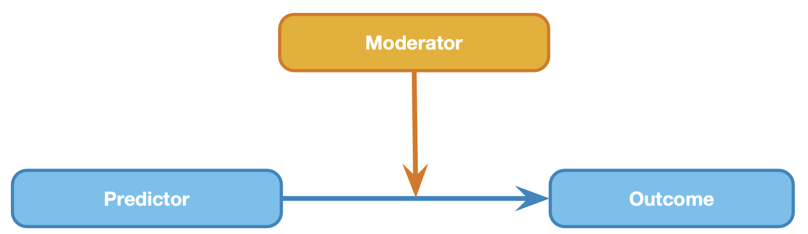
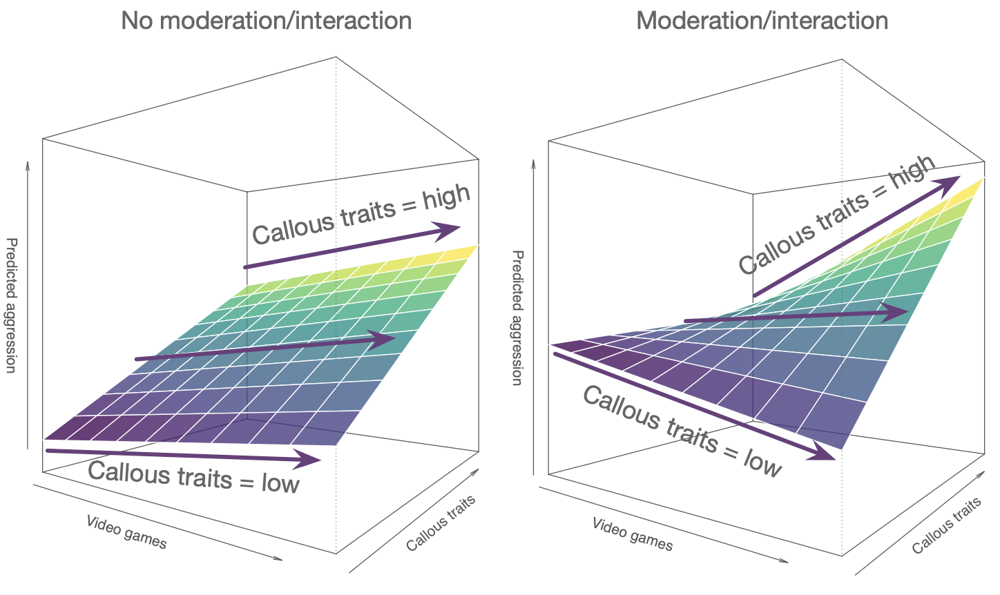

# Moderation {.section}

<!-- Allow color highlighting in mathjax -->
<script type="text/x-mathjax-config">
  MathJax.Hub.Config({ TeX: { extensions: ["color.js"] }});
</script>

```{r mod-moderation, echo=FALSE}
rm(list=ls())
source("../../_setup.R")
library("manipulateWidget")
```

## Moderation

In statistics and regression analysis, moderation occurs when the relationship between two variables depends on a third variable. The third variable is referred to as the moderator variable or simply the moderator. The effect of a moderating variable is characterized statistically as an interaction.

Source [WIKIPEDIA](https://en.wikipedia.org/wiki/Moderation_(statistics))

## Model {.subsection .flexbox .vcenter}

$\definecolor{red}{RGB}{255,0,0} \definecolor{black}{RGB}{0,0,0}
\color{black}Out_i = b_0 + b_1 Pred_i + b_2 Mod_i + \color{red}b_3 Pred_i \times Mod_i \color{black}+ \epsilon_i$



## Model {.subsection .flexbox .vcenter}



<!-- Copied verbatim from lecture 21 (regression_multiple_predictors.qmd, "Assumptions"), 2026-11-05.
     Where to check each one in JASP: L21's "Checking the assumptions", linked from the exam note. -->

## Assumptions {.subsection .smaller}

A selection from Field (8.3 Bias in linear models):

For simple regression

* Sensitivity
* Homoscedasticity
  * See [here](https://johnnydoorn.github.io/teaching-statistics/extra-texts/heteroscedasticity.html) for further illustration
* Linearity
* Normality


Additionally, for multiple regression

* Multicollinearity (Section 8.9)

<!-- ## Example {.smaller} -->

<!-- Video games are among the favorite online activities for young people: two-thirds of 5–16-year-olds have their own video games console, and 88% of boys aged 8–15 own at least one games console. Although playing violent video games can enhance visuospatial acuity, visual memory, probabilistic inference, and mental rotation, compared to games such as Tetris, these games have also been linked to increased aggression in youths Another predictor of aggression and conduct problems is callous-unemotional traits such as lack of guilt, lack of empathy, and callous use of others for personal gain.  -->

<!-- Imagine a scientist wanted to look at the relationship between playing violent video games such as Grand Theft Auto, MadWorld and Manhunt and aggression. She gathered data from 442 youths. She measured their aggressive behavior, callous unemotional traits, and the number of hours per week they play video games. -->

<!-- Source: Field 11.3.1 -->

<!-- ## Simulate data -->

<!-- # ```{r, echo=TRUE} -->
<!-- # set.seed(283) ##  -->
<!-- # predictor <-             rnorm(100, 0, 3) -->
<!-- # ml.coffee <- predictor + rnorm(100, 0, 3) ## multicollinearity -->
<!-- # error     <-             rnorm(100, 0, 3) ## error -->
<!-- # intercept <- 5 -->
<!-- # wakefulness   <- intercept + .5*predictor +  -->
<!-- #                         -.4*ml.coffee +  -->
<!-- #                          .4*predictor*ml.coffee +  -->
<!-- #                          error -->
<!-- # ``` -->
```{r mod-model, echo=FALSE}
set.seed(283) ## 
n <- 100
hours.awake <- round(runif(n, 1, 18))
ml.coffee   <- round(rnorm(n, 250, 90))
error       <- rnorm(n, 0, 20) ## error
intercept   <- 50
wakefulness <- intercept + -3 * hours.awake + 
                          0.3 * ml.coffee + 
                         0.1 * hours.awake * ml.coffee + 
                         error
# wakefulness <- 50 + scale(wakefulness)*(10)
wakefulness <- round(wakefulness, 2)   # as in datasets/2026/moderation-coffee.csv, so slides and JASP agree
```


<!-- ## Mean un centring -->

<!-- ```{r, echo=TRUE} -->
<!-- ml.coffee <- ml.coffee + 7 -->

<!-- head(data)  -->
<!-- ``` -->


## View data {.smaller}
```{r mod-view-data, echo=FALSE}
data <- data.frame(hours.awake, ml.coffee, wakefulness)
# save(data, file="moderation.rdata")
ssrTable(round(data,2), 
          rownames   = FALSE, 
          height     = 350,
          extensions = 'Buttons',
          options = list(dom = 'Bfrtip',
                         buttons = c('csv')))
```

## Correlations

```{r mod-correlations, echo=TRUE}
cor(data)
```

## Scatterplots {.subsection}

```{r mod-scatterplots, echo=FALSE, warning=FALSE, message=FALSE, prompt=FALSE, results='hide'}
plot(data, pch = 21, bg = palette.colors(n = 9, palette = "Okabe-Ito"))
attach(data)
```

## 3D plot

```{r mod-3d-plot, echo=FALSE, warning=FALSE, message=FALSE}
# Same look as the 3D tab of the MultiRegression applet and the L21 "Visual" slide: plot3D() from
# ../../plotFunctionsSSR.r (sourced by _setup.R). Data only here; planes and surface come later.
d3     <- data.frame(hours.awake, ml.coffee, wakefulness)
vars3d <- c(y = "wakefulness", x1 = "hours.awake", x2 = "ml.coffee")
p3d <- plot3D(d3, model = "none", vars = vars3d, pointName = "Participants")
p3d$width  <- 900
p3d$height <- 480
p3d
```

Take it for a spin

## Descriptives plot

```{r mod-descriptives-plot, echo=FALSE, warning=FALSE, message=FALSE, fig.width=7, fig.height=4, fig.align='center'}
# As JASP 0.98.8 draws it: Linear Regression > Descriptives Plots, hours.awake on the horizontal axis,
# ml.coffee as separate lines, default settings. A scale variable on the horizontal axis gives
# jaspGraphs::JASPScatterPlot() (palette colorblind3, linear fit + 95% CI per group). The separate-lines
# variable is binned as jaspRegression 0.96.5 .linregBinScaleVariable() does by default (method "sd",
# 3 groups): breaks at mean -/+ 0.5 SD, labels Low / Medium / High. coffeeBreaks and coffeeGroup are
# reused by the coffee-groups 3D slide below.
coffeeBreaks <- mean(ml.coffee) + c(-0.5, 0.5) * sd(ml.coffee)
coffeeGroup  <- cut(ml.coffee, breaks = c(-Inf, coffeeBreaks, Inf), labels = c("Low", "Medium", "High"),
                    include.lowest = TRUE)
oldPalette <- jaspGraphs::getGraphOption("palette")
jaspGraphs::setGraphOption("palette", "colorblind3")
suppressWarnings(print(jaspGraphs::JASPScatterPlot(
  x = hours.awake, y = wakefulness, group = coffeeGroup, xName = "hours.awake", yName = "wakefulness",
  showLegend = TRUE, addSmooth = TRUE, addSmoothCI = TRUE, smoothCIValue = 0.95, forceLinearSmooth = TRUE,
  plotAbove = "none", plotRight = "none", legendTitle = "ml.coffee")))
jaspGraphs::setGraphOption("palette", oldPalette)
```

## Coffee groups

```{r mod-coffee-groups, echo=TRUE}
## Where JASP's descriptives plot splits ml.coffee (default, 3 groups)
round(mean(ml.coffee) + c(-0.5, 0.5) * sd(ml.coffee), 1)
```

```{r mod-sd-and-quantile-planes, echo=FALSE}
# No longer on a slide (the planes now follow the descriptives plot's groups); kept because
# mod-prediction-surface saves sds and quantiles to moderation.rdata
sds       <- c(mean(ml.coffee)+(sd(ml.coffee)*c(-1,0,1)))
quantiles <- as.vector(quantile(ml.coffee,seq(.1,.9,.1)))
```

##

```{r mod-coffee-groups-3d-plot, echo=FALSE, warning=FALSE, message=FALSE}
# The descriptives plot's coffee groups in 3D: points in its colours (colorblind3 for 3 groups: Low,
# Medium, High) and grey planes at its two cut points (coffeeBreaks, mod-descriptives-plot chunk)
pPlanes <- plot3D(d3, model = "none", vars = vars3d, pointName = "Participants")
for (k in seq_along(coffeeBreaks)) {
  pPlanes <- plotly::add_surface(pPlanes, x = matrix(range(hours.awake), 2, 2), y = matrix(coffeeBreaks[k], 2, 2),
                                 z = matrix(range(wakefulness), 2, 2, byrow = TRUE), opacity = 0.35,
                                 showscale = FALSE, hoverinfo = "skip",
                                 colorscale = list(c(0, 1), rep("grey", 2)))   # CSS name: plotly.js has no grey50
}
groupCols <- jaspGraphs::JASPcolors("colorblind3", asFunction = TRUE)(nlevels(coffeeGroup))
pPlanes <- plotly::style(pPlanes, traces = 1,
                         marker = list(size = 3, color = groupCols[coffeeGroup], line = list(color = "black", width = 1)))
pPlanes$width  <- 900
pPlanes$height <- 520
pPlanes
```

## Fit model { .subsection}

```{r mod-fit-model, echo=TRUE}
fit <- lm(wakefulness ~ hours.awake + ml.coffee + hours.awake*ml.coffee); summary(fit)$coefficients
```

## Regression equation {.smaller .scrollable}

$\definecolor{red}{RGB}{255,0,0} \definecolor{black}{RGB}{0,0,0}
\color{black}\widehat{Out_i} = b_0 + b_1 Pred_i + b_2 Mod_i + \color{red}b_3 Pred_i \times Mod_i \color{black}$

$\definecolor{red}{RGB}{255,0,0} \definecolor{black}{RGB}{0,0,0}
\color{black}\widehat{Out_i} = `r round(fit$coefficients[1],2)` + `r round(fit$coefficients[2],2)` \times Pred_i + `r round(fit$coefficients[3],2)` \times Mod_i + \color{red} `r round(fit$coefficients[4],2)` \times Pred_i \times Mod_i \color{black}$

$\definecolor{red}{RGB}{255,0,0} \definecolor{black}{RGB}{0,0,0}
\color{black}\widehat{Out_i} = `r round(fit$coefficients[1],2)` + `r round(fit$coefficients[2],2)` \times `r hours.awake[1]` + `r round(fit$coefficients[3],2)` \times `r ml.coffee[1]` + \color{red} `r round(fit$coefficients[4],2)` \times `r hours.awake[1]` \times `r ml.coffee[1]` \color{black} \approx `r round(fit$fitted.values[1], 2)`$

```{r mod-regression-equation-function, echo=FALSE}
regeq <- function(model, hours.awake, ml.coffee) { 
    fit$coefficients[1] + 
    fit$coefficients[2]*hours.awake + 
    fit$coefficients[3]*ml.coffee + 
    fit$coefficients[4]*hours.awake*ml.coffee
}

x.pre <- seq(0,20,length.out=30)
y.mod <- seq( 0,450,length.out=30)

z.pre <- outer(x.pre, y.mod, FUN='regeq', model=fit)
data$prediction <- fit$fitted.values
data <- round(data, 2)
ssrTable(data, rownames = FALSE, 
          height = 300,
          extensions = 'Buttons',
          options = list(dom = 'Bfrtip',
                         buttons = c('csv')))
```

```{r mod-prediction-surface, echo=FALSE}
colnames(z.pre) <- x.pre
rownames(z.pre) <- y.mod
save(data, x.pre, y.mod, z.pre, quantiles, sds, file="moderation.rdata")
```


## Expected surface

```{r mod-expected-surface, echo=FALSE, warning=FALSE, message=FALSE}
# Twisted plane of wakefulness ~ hours.awake * ml.coffee (the fit above), as in the applet's 3D tab
pSurface <- plot3D(d3, model = "full", vars = vars3d, pointName = "Participants")
pSurface$width  <- 900
pSurface$height <- 520
pSurface
```


## Expected values {.subsection}


```{r mod-expected-values, fig.align='center', fig.width=15, fig.height = 7, echo=FALSE}
par(mfrow = c(1, 3), cex = 1.5)
data$prediction <- prediction <- fit$fitted.values

plotN <- 10
outcome <- data$wakefulness
# This is all the sales data
plot(outcome[1:plotN],xlab='Participant', ylab = "Outcome", las = 1,
     bty = "n", pch = 21, bg = "turquoise", main = "Total Variance")
# With the mean
abline(h = mean(outcome[1:plotN]), lwd = 2, col = "purple")
# The model predicts the sales scores
# points(1:plotN,prediction[1:plotN], pch =23, bg='darkred')
# The part of the variation that overlaps is the 'explained' variance. 
segments(1:plotN, outcome[1:plotN], 1:plotN, mean(outcome[1:plotN]), col='orange', lwd= 2)

legend("topleft", c("Observed"),
       bty = "n", fill = c("turquoise"))

# This is all the sales data
plot(outcome[1:plotN],xlab='Participant', ylab = "Outcome", las = 1,
     bty = "n", pch = 21, bg = "turquoise", main = "Explained Variance")
# With the mean
abline(h = mean(outcome[1:plotN]), lwd = 2, col = "purple")
# The blue lines are the total variance, the deviation from the mean.
segments(1:plotN, prediction[1:plotN], 1:plotN, mean(outcome[1:plotN]), col='blue', lwd= 2)
# The model predicts the sales scores
points(1:plotN, prediction[1:plotN], pch =23, bg='darkred')
# The part of the variation that overlaps is the 'explained' variance. 
legend("topleft", c("Observed", "Predicted"),
       bty = "n", fill = c("turquoise", "darkred"))

# This is all the sales data
plot(outcome[1:plotN],xlab='Participant', ylab = "Outcome", las = 1,
     bty = "n", pch = 21, bg = "turquoise", main = "Unexplained Variance")
# With the mean
# abline(h = mean(sales[1:plotN]), lwd = 2, col = "purple")
# The blue lines are the total variance, the deviation from the mean.
segments(1:plotN, prediction[1:plotN], 1:plotN, (outcome[1:plotN]), col='red', lwd= 2)
# The model predicts the sales scores
points(1:plotN,prediction[1:plotN], pch =23, bg='darkred')
# The part of the variation that overlaps is the 'explained' variance. 
legend("topleft", c("Observed", "Predicted"),
       bty = "n", fill = c("turquoise", "darkred"))
```
$r^2$ is the proportion of <span style="color: blue;">blue</span> to <span style="color: orange;">orange</span>, while $1 - r^2$ is the proportion of <span style="color: red;">red</span> to <span style="color: orange;">orange</span> 

## Expected vs. observed {.subsection}

```{r mod-expected-vs-observed, fig.align='center', echo=FALSE}
 plot(prediction, outcome, las = 1, ylab = "Outcome", xlab = "Model Prediction", 
      main =  bquote("r ="~ .(round(cor(prediction, outcome), 3)) ~ "," ~ r^2 ~ " = " ~ .(round(cor(prediction, outcome)^2, 3))), 
       pch = 21, bg = "turquoise", bty = "n")
  fit <- lm(outcome ~ prediction)
  abline(fit, col = "purple", lwd = 2)

```
  
## Turn quantitative into ordinal?!

```{r mod-turn-quantitative-into-ordinal}
## Round to number of cups of coffee, always rounding down
data$cups.coffee <- data$ml.coffee %/% 150
```

```{r mod-round-to-cups, echo=FALSE}
# The overview's copy of the data, for the JASP demo (cups.coffee as continuous, then as categorical):
# no prediction column; cups.coffee holds 3 integers (0, 1, 2), which JASP imports as ordinal. Rows
# stable-sorted by cups.coffee, so its levels come in as 0, 1, 2 even with JASP's "Order labels by
# value" off (Johnny's setting), and 0 is the reference level for everyone.
coffeeCsv <- data[order(data$cups.coffee), c("hours.awake", "ml.coffee", "wakefulness", "cups.coffee")]
write.csv(coffeeCsv, datasetsPath("2026", "moderation-coffee.csv"), row.names = FALSE)
ssrTable(round(data,2)[, c(2, 5)],
          rownames   = FALSE, 
          height     = 350)
```

