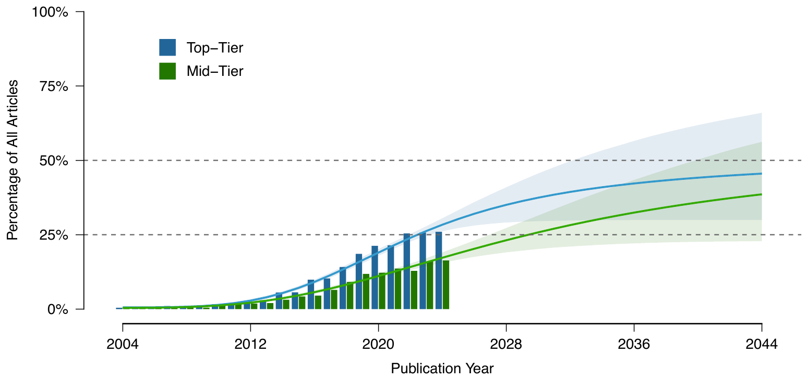
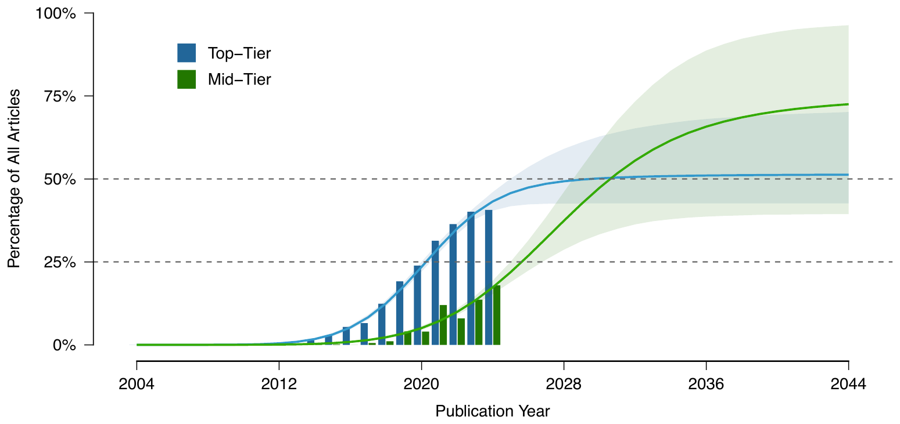
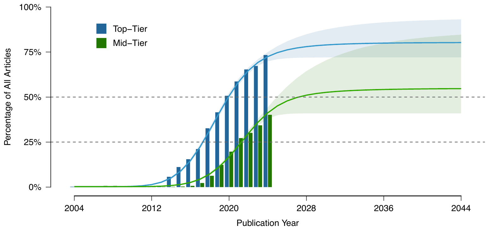
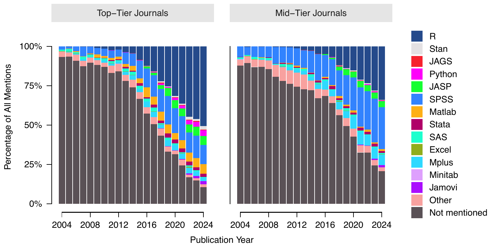
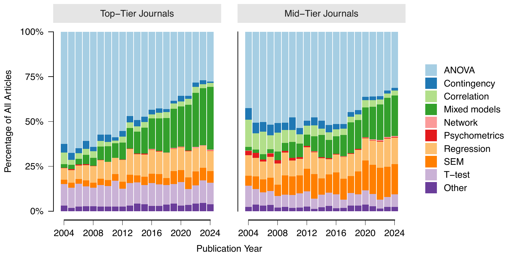

<!-- Close of the last SSR lecture (2026-11-12, his flow): Bayes -> Bayes and open science in the
     wild (Pfadt et al. figures) -> the three SSR themes, which stand on their own and are not tied
     to the figures. Figures are cropped from the preprint PDF in statbooks/articles/ (Figs 1, 2, 3,
     6, 5; Fig 4 estimation focus is unused). Slide text is a draft awaiting his OK. -->

## Bayes and open science in the wild

[Pfadt et al. (2026)](https://osf.io/preprints/psyarxiv/ck3js_v3): *The prevalence of Bayesian inference, preregistration, and open data in psychology, 2004–2024*, 45 authors

## Bayesian analyses

Source: [Pfadt et al. (2026)](https://osf.io/preprints/psyarxiv/ck3js_v3), Fig. 1

## Preregistration

Source: [Pfadt et al. (2026)](https://osf.io/preprints/psyarxiv/ck3js_v3), Fig. 2

## Open data

Source: [Pfadt et al. (2026)](https://osf.io/preprints/psyarxiv/ck3js_v3), Fig. 3

## Software reporting

Source: [Pfadt et al. (2026)](https://osf.io/preprints/psyarxiv/ck3js_v3), Fig. 6

## Analysis types

Source: [Pfadt et al. (2026)](https://osf.io/preprints/psyarxiv/ck3js_v3), Fig. 5

<!-- The three themes hang on the course's own formula (L12 "DV = Model + Error", L21
     "Outcome = Model Prediction + Error", L28 "Error = Observed - Model"): model -> relative,
     error -> assumptions, the whole thing -> reporting (his yes, 2026-11-12). One table instead
     of three thin numbered slides (his call, 11-12). Metrics are named in the next table. -->

## Looking back on SSR {.smaller}

$$\text{Outcome} = \text{Model} + \text{Error}$$

| | Theme | In SSR |
|----|-------|------------------|
| Model | Statistics is relative | Many tests compare the predictions of two models (interaction vs main effects, $\mathcal{M}_1$ vs $\mathcal{M}_0$) Bayes makes the comparison explicit |
| Error | Threats to statistical validity | Most assumptions are about the residuals, get a grip on these Robust alternatives exist, but are usually less powerful Many choices along the way |
| All of it | Complete reporting | Numbers for accuracy (effect size, hypothesis test) Graphs for vibes |

<!-- Metrics as taught: d (L11, L12, L17), r (L6), R2 (L9, L21), omega2 (L12, L13, L17),
     rank-biserial (L20), odds ratio (L28), R2/F change + adjusted R2 (L21, L26 model summary
     tables), posterior + credible interval, BF10 and BFincl (L29). -->

## Metrics we have used {.smaller}

| Question | Metrics |
|----------|---------|
| Do we have evidence for an effect? | $p$-value ($t$, $F$, $\chi^2$), $\text{BF}_{10}$ |
| Which model predicted the data the best? | $R^2$/$F$ change + $p$, adjusted $R^2$, $\text{BF}_{10}$, $\text{BF}_{\text{incl}}$ |
| How big is the effect? | $d$, $r$, $R^2$, $\omega^2$, rank-biserial $r$, odds ratio |
| How precise is this effect estimate? | Standard error, 95% CI, 95% credible interval |

<!-- Fisher's evidential p-value is the L3 callback (Fisher, 1956 quote in NHST_3.qmd). BIC
     approximates the BF: BF01 ~ exp((BIC1 - BIC0) / 2) (Wagenmakers, 2007). -->

## Alternatives we have not discussed (not exam material) {.smaller .scrollable}

- Equivalence testing
  - Is the effect small enough to ignore? ([Lakens et al., 2018](https://doi.org/10.1177/2515245918770963))
- $p$-value as evidence, without $\alpha$ (Fisher's original idea)
  - Smaller $p$, stronger evidence against $H_0$
  - Common in practice
- AIC / BIC
  - Model fit with a penalty for complexity
  - BIC approximates the Bayes factor
- Multiverse analysis
  - What if we had made other choices? ([Steegen et al., 2016](https://doi.org/10.1177/1745691616658637))
